# GitHub Review: a multi-agent GitHub profile reviewer

This is a Claude Code multi-agent system that reviews a GitHub profile against a fixed set of
**19 written rules**. The profile is the header, the profile README and the pinned flagship repos.

- A **collector** reads the profile through the `gh` CLI.
- At the same time, a **benchmark** agent studies three north-star profiles.
- Next, **four reviewers** run in parallel: Profile, Projects, Engineering signal and Architect layer.
- Finally, a **synthesis** agent merges their reviews into one validated, scored run.

A private Cloudflare web app shows the result on desktop and iPhone. Its 3D **Office** tab
replays each run, with the agents as robots in a lab office building.

One command runs everything: `/review-github`. The system uses only a Claude subscription: Claude Code subagents plus
the `gh` CLI, with no API keys.

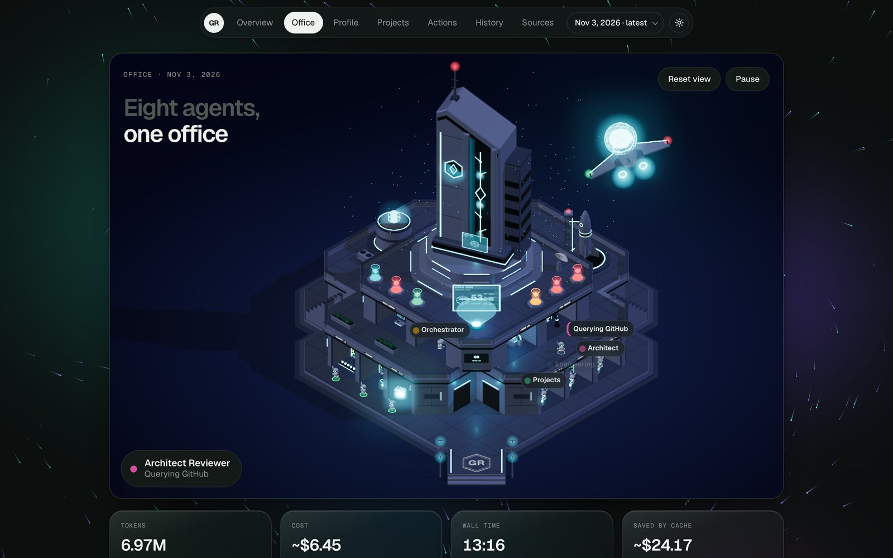


---

## Contents

- [What it does](#what-it-does)
- [Features](#features)
- [Architecture](#architecture)
- [The agents](#the-agents)
- [The rules](#the-rules)
- [A run, step by step](#a-run-step-by-step)
- [Results and scorecard](#results-and-scorecard)
- [Pipeline metrics](#pipeline-metrics)
- [The web app](#the-web-app)
- [The Office](#the-office)
- [Design choices](#design-choices)
- [Project layout](#project-layout)
- [Run it yourself](#run-it-yourself)
- [Security and privacy](#security-and-privacy)
- [Limitations](#limitations)
- [Author & Certifications](#-author--certifications)

## What it does

"Review my GitHub" is too vague for one model: it drifts toward star counts and generic advice.
This system makes the review **specific, evidenced and repeatable**:

- **Rules first.** [`context/rules.md`](context/rules.md) holds 19 rules in four sections and is the
  only scoring criteria. Every finding maps to exactly one rule, carries evidence (a file path, a README
  line, a workflow run) and has a concrete fix.
- **Deterministic scores.** The agents give each result a status: pass, partial, fail or n/a.
  [`scripts/scoring.py`](scripts/scoring.py) then computes every rule, section, repo and overall score
  from those statuses. The model never picks a number.
- **North stars are examples, not targets.** The benchmark agent records how three strong data
  engineering profiles (josephmachado, EcZachly, sspaeti) handle each rule, citing sources. The app
  shows them next to each finding. They never change a score.
- **Never invents data.** If the collector can't read a field, the field stays `null` and the gap
  is listed in `missing_fields`. Reviewers never fill gaps.
- **Read-only.** Agents use `gh api` GETs only. They read and suggest, and they never edit a repo.
- **Tracks change.** Each run lists what changed since the previous run, and the app keeps every run.

## Features

| Area | Feature |
|---|---|
| **Orchestration** | The `/review-github` Claude Code skill runs a 6-step pipeline: preflight → collect ∥ benchmark → 4 reviewers in parallel → synthesis → validate + publish → stats |
| **Collection** | `collect.py` + the collector agent use GraphQL and REST GETs through `gh`. They read the header, profile README, pinned and README-linked repos, and for each repo its README, tree, CI runs, tests, Makefile/Docker, `.env.example`, ADRs, IaC and recent commits |
| **Parallel review** | Four reviewers run as independent subagents with their own contexts at the same time, all from the same profile JSON |
| **Scoring** | Each rule is pass 1.0, partial 0.5, fail 0 or n/a (excluded). A rule's score is the mean over its results, a section is the mean of its rules × 100, and the overall score is the mean of the four sections |
| **Portfolio decisions** | Each repo gets a keep / improve / replace verdict, within a 4–6 repo cap. A replace verdict comes with a brief for the ideal replacement project |
| **Paste-ready rewrites** | Exact `before` → `after` text for the bio, the README intro, the stack row and missing README sections, with copy buttons in the app |
| **Validation** | `validate_run.py` checks the schema version, required sections, unique ids across findings, rewrites and briefs, and that every reference resolves. Nothing is published unless it prints OK |
| **Agent telemetry** | `agent_stats.py` reads the Claude Code transcripts and records tokens, approximate cost, timing and tool-call kinds per agent (numbers only) |
| **Web app** | Vanilla JS with no build step and seven tabs. Light/dark themes, a mobile bottom bar and a home-screen app on iPhone. Actions ticks are saved to KV and sync across devices |
| **The Office** | A three.js replay of each run: robots, rooms, a tower, a drone, a rocket that launches on publish, score pillars per repo and frosted info cards on click |

## Architecture

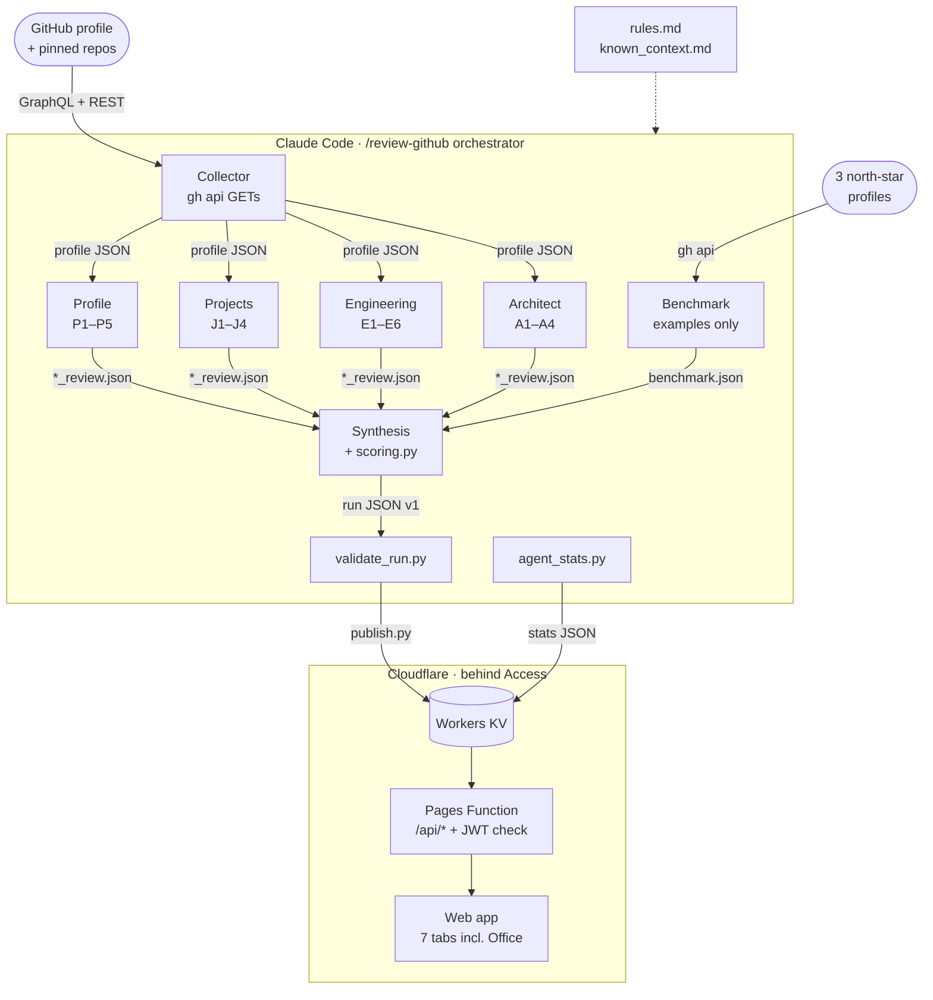

## The agents

| Agent | Rules | Tools | Output |
|---|---|---|---|
| **Orchestrator** | — | Agent, Bash | Run id, preflight, launches subagents, validates, publishes, reports |
| **Collector** | — | Bash (`collect.py`, `gh api`) | `data/profiles/<RUN_ID>.json`: header, README, in-scope repos with their signals, `missing_fields` |
| **Benchmark** | all (examples only) | Bash (`gh api`) | How each north-star profile handles each rule, with cited sources |
| **Profile reviewer** | P1–P5 | Read, Write, Bash | Findings for the header and profile README; paste-ready bio and README rewrites |
| **Projects reviewer** | J1–J4 | Read, Write, Bash | Per-repo findings; keep / improve / replace verdicts; replacement briefs (stack, public dataset, patterns, effort) |
| **Engineering reviewer** | E1–E6 | Read, Write, Bash | Per-repo findings on layout, tests/CI, data quality, one-command runs, secrets and commits |
| **Architect reviewer** | A1–A4 | Read, Write, Bash | Per-repo findings on ADRs, design docs, patterns, IaC and environment promotion |
| **Synthesis** | merge | Read, Write, Bash | One schema-v1 run: scores, findings, rewrites, portfolio, action plan, changes since last run |

Every agent reads [`context/known_context.md`](context/known_context.md) first. That file holds the facts
Felipe has confirmed (scope, target role, platforms, portfolio cap), so a settled fact is never raised as a
finding again.

## The rules

| Section | Id | Rule |
|---|---|---|
| **Profile** | P1 | Lead with your projects: a short, text-first README with your name, a one-line role and your focus areas |
| | P2 | Make the top of the README answer "what does this person build?" without scrolling |
| | P3 | Keep the stack row to 8–12 tools you use in production |
| | P4 | Add one row of contact badges and certifications |
| | P5 | Skip trophies, stats cards, streaks and visitor counters |
| **Projects** | J1 | Pin 4–6 flagship repos; archive or privatize noise |
| | J2 | Build end-to-end pipelines, not isolated notebooks |
| | J3 | Each README covers the problem, an architecture diagram, the stack, how to run it and quantified results |
| | J4 | Use realistic data at meaningful scale; state row counts and runtimes |
| **Engineering** | E1 | Modular `src/` layout, consistent across repos |
| | E2 | Tests, linting, type hints and CI (GitHub Actions) |
| | E3 | Data quality checks, logging, idempotent loads and error handling |
| | E4 | Reproducible with one command (`make up`, Docker, Codespaces) |
| | E5 | Never commit secrets; use `.env.example` |
| | E6 | Clean commit history with small, descriptive commits |
| **Architect** | A1 | ADRs explaining why one option was chosen over another |
| | A2 | Design docs covering scalability, cost, governance and security |
| | A3 | Patterns, not just tools: medallion, CDC, SCD2, data contracts, lineage |
| | A4 | IaC (Terraform/Bicep) and environment promotion (dev → test → prod) |

## A run, step by step

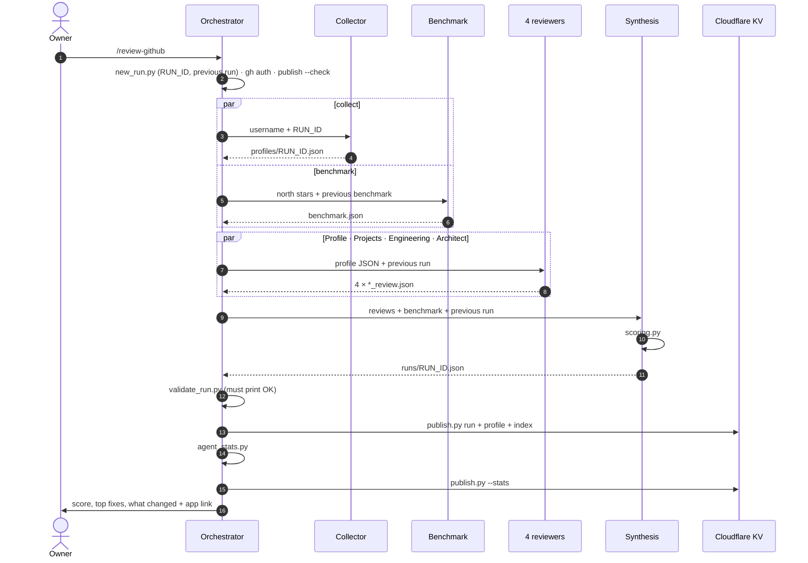

| Step | Who | Does |
|---|---|---|
| 0 | Orchestrator | `new_run.py` makes `RUN_ID` (`r<YYYYMMDD>-<HHMM>`, Bogotá time); checks `gh auth` and that wrangler can reach KV |
| 1 | Collector ∥ Benchmark | Profile JSON and north-star patterns, in parallel |
| 2 | 4 reviewers | Run in parallel; each writes one JSON file to `data/work/<RUN_ID>/` |
| 3 | Synthesis | Merges the reviews, runs `scoring.py`, writes `data/runs/<RUN_ID>.json` |
| 4 | Orchestrator | `validate_run.py` → `publish.py` to Workers KV |
| 5 | Orchestrator | `agent_stats.py` → `publish.py --stats` for the Office tab |
| 6 | Orchestrator | A short report: score, top fixes, plan, what changed |

## Results and scorecard

These figures come from the latest run, `r20261103-1619` (Nov 3, 2026), of
[github.com/felipecastro-data](https://github.com/felipecastro-data).

### Run at a glance

| Overall | Findings | Pass · Partial · Fail · n/a | Paste-ready rewrites | Plan items | North-star sources |
|:-:|:-:|:-:|:-:|:-:|:-:|
| **53 / 100** | **84** | 24 · 39 · 20 · 1 | **10** | **14** (4 week · 5 month · 5 quarter) | **14** |

| In-scope repos | With CI | With tests | With ADRs | With IaC |
|:-:|:-:|:-:|:-:|:-:|
| **6** (6 pinned) | 3 / 6 | 2 / 6 | 1 / 6 | 3 / 6 |

### Section scores

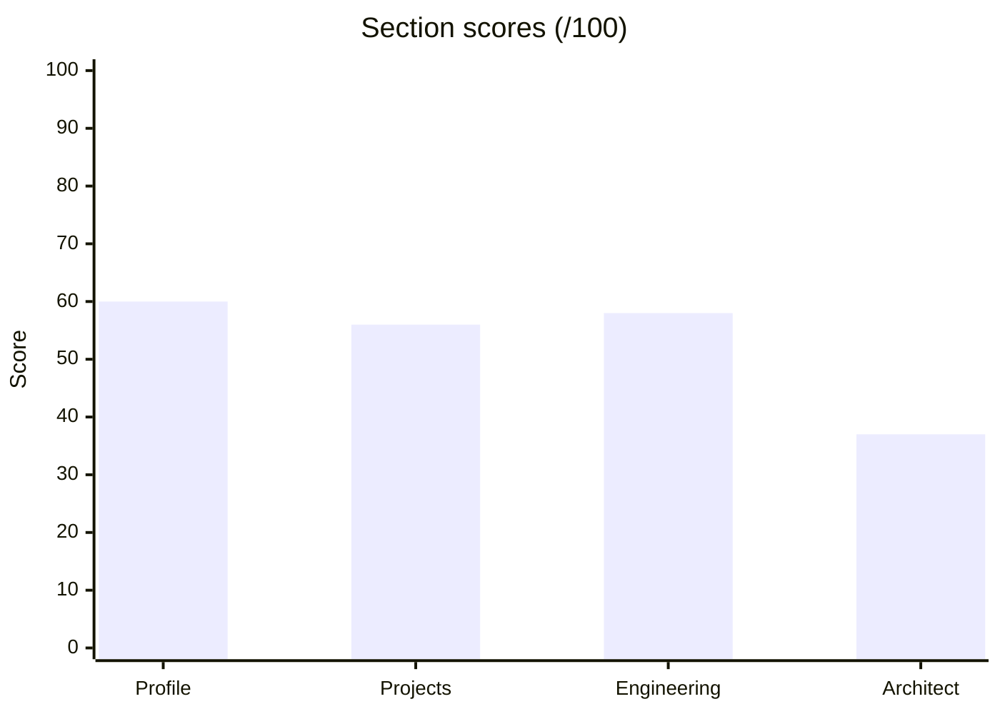

The Architect layer is the gap. Only one repo records decisions as ADRs (A1), and design docs on
scalability, cost, governance and security (A2) are mostly missing. That is the evidence a
Senior Data Engineer → Data Architect move needs, so it leads the action plan.

### Rule scores

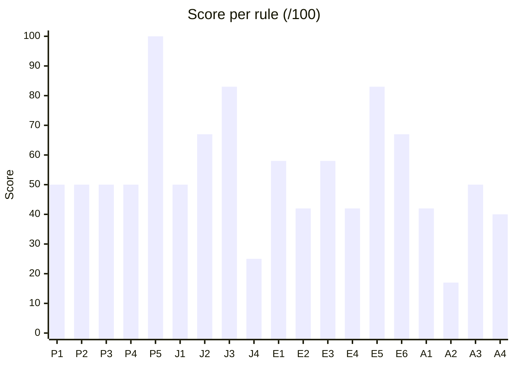

### Scorecard: rule × repo

✅ pass · 🟡 partial · ❌ fail · — n/a. P1–P5 and J1 are judged once per profile:
🟡 🟡 🟡 🟡 ✅ · 🟡.

| Rule | [Medallion CI/CD](https://github.com/felipecastro-data/fabric-medallion-cicd-terraform) | [Stock volatility](https://github.com/felipecastro-data/real-time-stock-volatility-fabric) | [Governance as code](https://github.com/felipecastro-data/lakehouse-governance-as-code) | [Domain + Purview](https://github.com/felipecastro-data/fabric-domain-architecture-purview-governance) | [Dictionary RAG](https://github.com/felipecastro-data/medallion-data-dictionary-rag-system) | [Self-healing](https://github.com/felipecastro-data/self-healing-databricks-pipeline-multi-agent) | Score |
|---|:-:|:-:|:-:|:-:|:-:|:-:|--:|
| J2 end-to-end | ✅ | 🟡 | ✅ | 🟡 | 🟡 | 🟡 | 67 |
| J3 README | ✅ | 🟡 | ✅ | ✅ | 🟡 | ✅ | 83 |
| J4 real scale | 🟡 | ❌ | 🟡 | 🟡 | ❌ | ❌ | 25 |
| E1 `src/` layout | ✅ | ❌ | ✅ | 🟡 | 🟡 | 🟡 | 58 |
| E2 tests + CI | ✅ | ❌ | ✅ | 🟡 | ❌ | ❌ | 42 |
| E3 data quality | ✅ | ❌ | ✅ | 🟡 | 🟡 | 🟡 | 58 |
| E4 one command | 🟡 | ❌ | ✅ | 🟡 | 🟡 | ❌ | 42 |
| E5 secrets | ✅ | ✅ | ✅ | 🟡 | ✅ | 🟡 | 83 |
| E6 commits | ✅ | ❌ | 🟡 | ✅ | 🟡 | ✅ | 67 |
| A1 ADRs | ❌ | ❌ | ✅ | 🟡 | 🟡 | 🟡 | 42 |
| A2 design docs | ❌ | ❌ | 🟡 | 🟡 | ❌ | ❌ | 17 |
| A3 patterns | 🟡 | 🟡 | ✅ | 🟡 | 🟡 | ❌ | 50 |
| A4 IaC + promotion | ✅ | ❌ | 🟡 | 🟡 | — | ❌ | 40 |
| **Repo score** | **73** | **19** | **85** | **58** | **42** | **35** | |
| **Verdict** | keep | replace | keep | keep | improve | improve | |

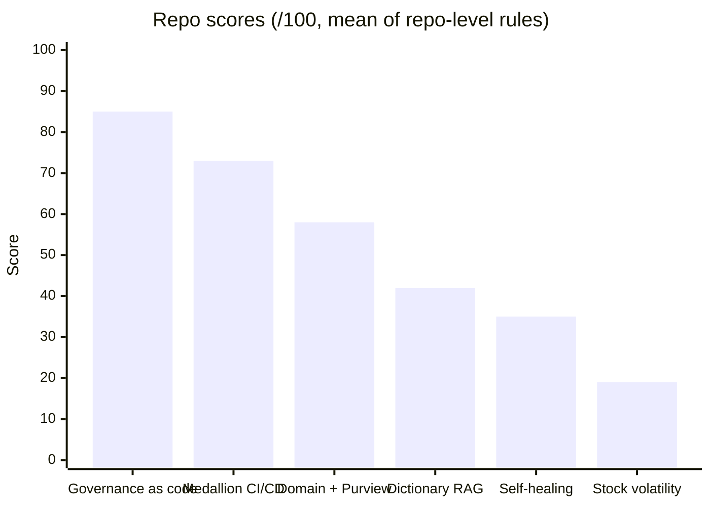

The projects reviewer recommends replacing the notebook-only stock volatility repo with a
**Fabric real-time bike availability** project (streaming + CDC/SCD2 on the Divvy platform). That keeps
the portfolio at six repos.

## Pipeline metrics

These figures come from the stats file `agent_stats.py` wrote for the same run. Input and cache tokens are
exact. Output tokens are estimated from visible text, so **costs are approximate API list prices**. The
run itself is billed to the Claude subscription, not per token.

### Run at a glance

| Wall time | Tokens | Model requests | Tool calls | Cost (approx.) | Saved by cache |
|:-:|:-:|:-:|:-:|:-:|:-:|
| **13:16** | **6.97M** | **120** | **123** | **~$6.45** | **~$24.17** |

### Timeline

The collector and the benchmark start together, and the four reviewers start together once both are back.
Synthesis waits for the slowest reviewer.

```mermaid
gantt
    title Run r20261103-1619 (mm:ss from start)
    dateFormat HH:mm:ss
    axisFormat %M:%S
    section Orchestrator
    Preflight, launch, validate, publish :done, 00:00:00, 00:13:16
    section Collect
    Collector                 :active, 00:00:19, 00:01:15
    Benchmark                 :active, 00:00:19, 00:03:08
    section Review
    Profile (P)               :crit, 00:03:21, 00:04:51
    Projects (J)              :crit, 00:03:21, 00:07:19
    Architect (A)             :crit, 00:03:21, 00:07:08
    Engineering (E)           :crit, 00:03:20, 00:10:07
    section Merge
    Synthesis                 :00:10:17, 00:13:04
```

### Tokens and cost by agent

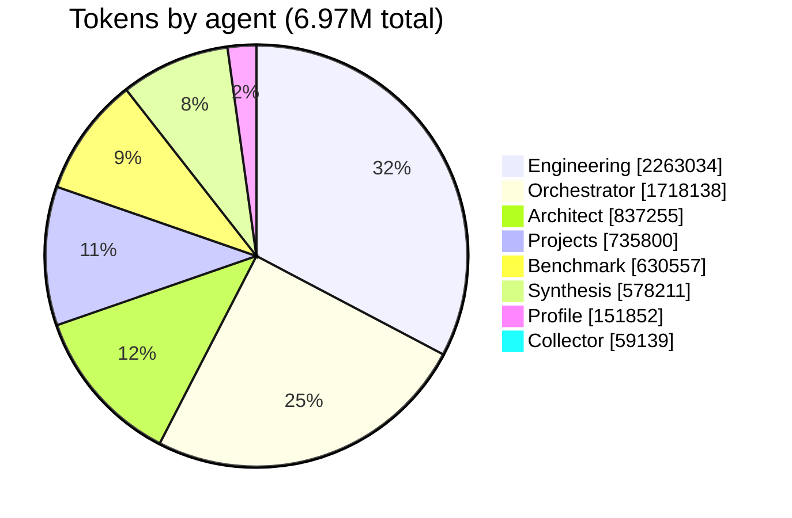

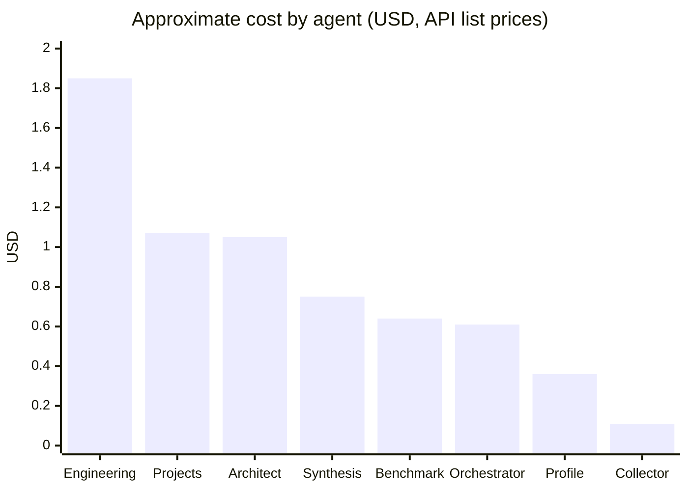

| Agent | Model | Tokens | Requests | Tool calls | Duration | Cost ≈ |
|---|---|--:|--:|--:|--:|--:|
| Orchestrator | Opus 5.5 | 1,718,138 | 17 | 16 | 13:16 | $0.61 |
| Collector | Opus 5.5 | 59,139 | 5 | 5 | 0:55 | $0.11 |
| Benchmark | Opus 5.5 | 630,557 | 19 | 19 | 2:49 | $0.64 |
| Profile reviewer | Opus 5.5 | 151,852 | 7 | 7 | 1:30 | $0.36 |
| Projects reviewer | Opus 5.5 | 735,800 | 13 | 13 | 3:57 | $1.07 |
| Engineering reviewer | Opus 5.5 | 2,263,034 | 28 | 29 | 6:47 | $1.85 |
| Architect reviewer | Opus 5.5 | 837,255 | 17 | 18 | 3:47 | $1.05 |
| Synthesis | Opus 5.5 | 578,211 | 14 | 16 | 2:47 | $0.75 |
| **Total** | | **6,973,986** | **120** | **123** | **13:16** | **$6.45** |

The engineering reviewer is the most expensive agent because E1–E6 means reading trees, workflows, tests
and commit logs for six repos. Most of the work is cheap because the collector front-loads
GitHub into one JSON file: **91% of all tokens are cache reads** (6.36M), and the cache saves almost four
times what the run costs.

### Tool calls by kind

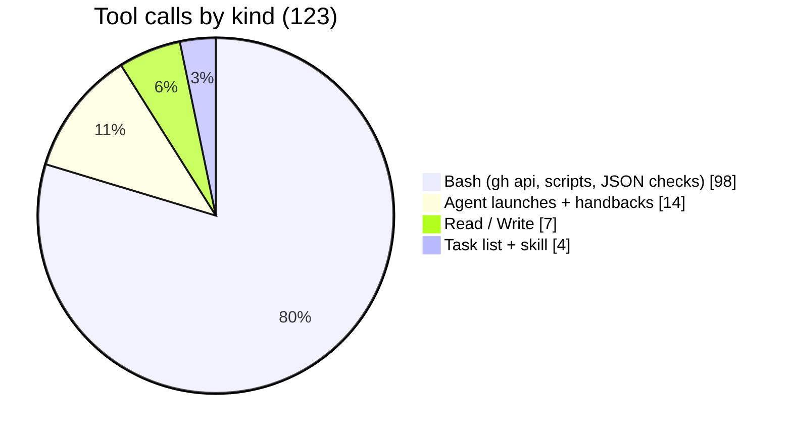

There is no web search and no web fetch: every GitHub fact, including the north stars, comes through `gh api`.

## The web app

A private dashboard on **Cloudflare Pages**, behind **Cloudflare Access**. A Pages Function serves
`/api/*` from Workers KV and verifies the Access JWT itself. It can be installed as a home-screen app on
iPhone. A run picker switches between every published run.

| Tab | Shows |
|---|---|
| **Overview** | The overall score with the headline fix, section bars, the top fixes and the full rule × repo scorecard |
| **Office** | The 3D pipeline replay plus agent metrics (below) |
| **Profile** | Header card, P1–P5 with evidence and fixes, paste-ready bio and README rewrites |
| **Projects** | Portfolio verdicts, repo scores, per-repo findings across J, E and A, replacement briefs |
| **Actions** | This week / month / quarter plan with a checklist saved to KV |
| **History** | Score trend per section and every run, newest first |
| **Sources** | North-star examples per rule and every source the benchmark cited |

<p>
  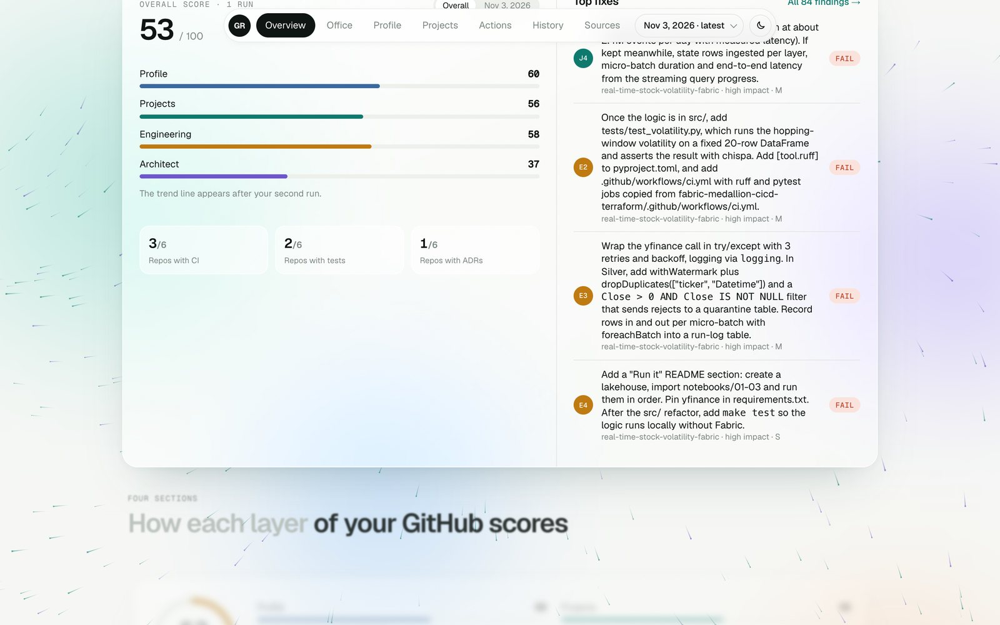
</p>

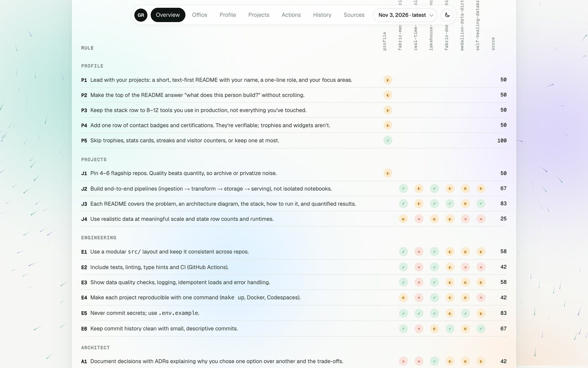

<p>
  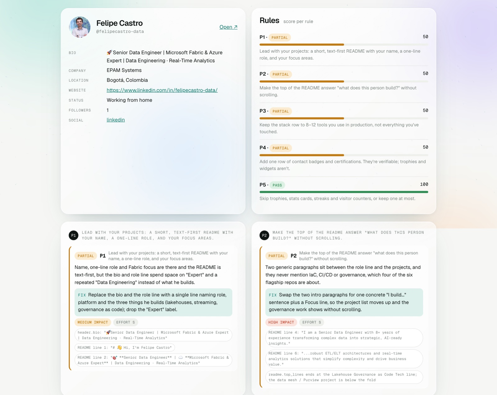
  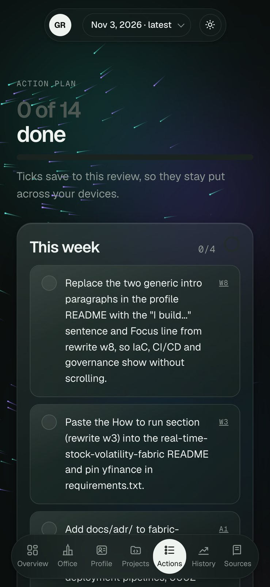
</p>

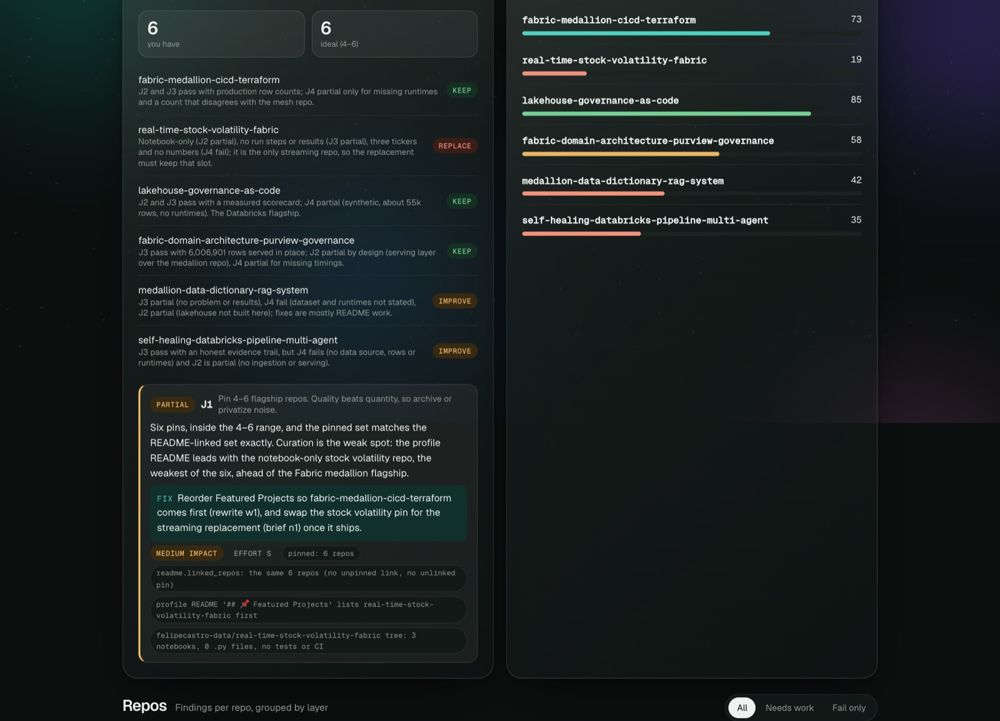

## The Office

The Office is a 3D tab ([`cloudflare/public/town.js`](cloudflare/public/town.js)). It uses three.js 0.170 ES modules from
jsDelivr and loads the first time the tab opens. It shows the **pipeline**, not the analysis.

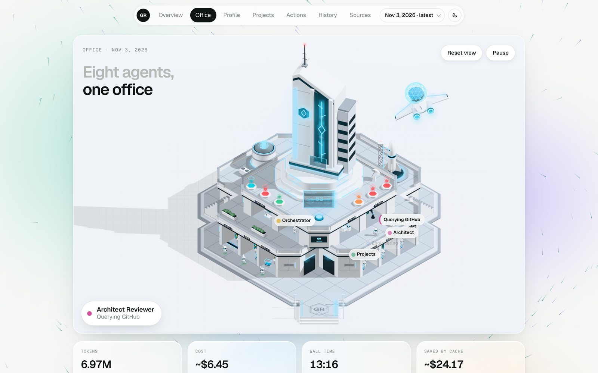

- **The scene:** one white lab building seen from above: two terrace levels, a central tower with a glowing
  glass slot and a rooftop compute core. Each agent has its own room (a library, review labs with wall screens,
  a command deck), and a rocket waits on its deploy pad.
- **Robots and replay:** eight robots with floating heads and glowing visors replay the run as a loop of under a minute (about 17× for this run). They walk to
  the briefing, work in their rooms and hand results back. Status bubbles show what each one is doing,
  based on its real tool calls.
- **Benchmark drone:** a drone with a glass brain flies out while the benchmark agent studies the north stars.
- **Score pillars:** one hex hologram pillar per in-scope repo, coloured by its score.
- **Publishing:** the rocket launches when the run is published.
- **Interaction:** click any robot, room, pillar or the core to open a frosted card with its goal, tokens, cost,
  time and tool calls. Drag to turn and scroll to zoom. Reset view and Pause are in the corner.
- **Rendering:** neutral (light) and ACES (dark) tone mapping, soft shadows, selective bloom on neon edges and static batching keep the frame
  rate near 60 fps on a MacBook. It runs in light and dark themes.
- **Metrics below the scene:** totals, a **Run replay** timeline, **Where the cost goes** by token type, and
  **Compare runs** across every run with stats.

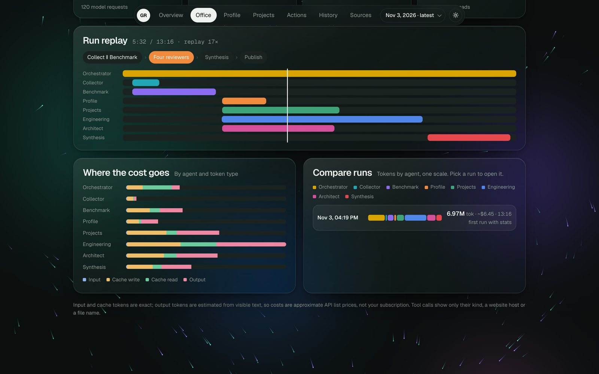

The data comes from `scripts/agent_stats.py`. It writes only numbers, tool-event kinds and generic file
names, never prompts, commands or profile content.

## Design choices

- **Four narrow reviewers instead of one broad one.** Each reviewer judges only its own rule ids, so a
  profile-copy opinion can't leak into an engineering score. Finding ids are prefixed per agent
  (`p*`, `j*`, `e*`, `a*`), and rewrite ids are split (`w1`–`w49` profile, `w50`+ projects) so merges never clash.
- **Statuses from the model, numbers from code.** Agents decide pass, partial or fail with evidence;
  `scoring.py` does the arithmetic. Runs can still drift by a status, but never by a made-up number.
- **Collector first, reviewers read a file.** One collection pass feeds four reviewers, so GitHub is queried
  once and the reviewers work mostly from cache.
- **Shared known context.** Confirmed facts live in one file every agent reads first, instead of being patched
  into each prompt after a bad run.
- **Local by design.** The pipeline runs in Claude Code on a Mac with the owner's `gh` login, not in CI.
- **No framework.** The app is vanilla JS and CSS with no build step (`npm run build` only turns `rules.md`
  into JSON). The Python scripts use only the standard library.

## Project layout

```
.claude/
  skills/review-github/SKILL.md     orchestrator (/review-github, steps 0–6)
  agents/collector.md               gh api → profile JSON
  agents/benchmark.md               north-star patterns per rule (examples only)
  agents/profile-reviewer.md        P1–P5 + bio/README rewrites
  agents/projects-reviewer.md       J1–J4 + keep/improve/replace + replacement briefs
  agents/engineering-reviewer.md    E1–E6 per repo
  agents/architect-reviewer.md      A1–A4 per repo
  agents/synthesis.md               merges everything into one run
  launch.json                       local preview server
context/
  rules.md                          the 19 rules (only scoring criteria)
  known_context.md                  confirmed facts every agent follows
  schema.md                         profile, review and run JSON shapes
scripts/
  new_run.py                        run id, paths, previous run
  collect.py                        read-only GraphQL + REST through gh
  scoring.py                        scores exactly as rules.md defines them
  validate_run.py                   checks a run before publishing
  publish.py                        puts runs, profiles, stats and the index into KV (--local for dev)
  agent_stats.py                    per-agent tokens, cost, timing for the Office tab
  build_app.py                      rules.md → public/rules.json
cloudflare/
  functions/api/[[path]].js         /api/* over KV, verifies the Access JWT
  public/                           index.html, app.js, app.css, theme.js, town.js (Office tab), icons, manifest, _headers (CSP)
  wrangler.toml                     KV binding, Access team domain and AUD
docs/                               screenshots used in this README
data/                               runs, profiles, stats, work files (gitignored)
```

## Run it yourself

| Requirement | For |
|---|---|
| Claude Code (Claude subscription) | Running the agents |
| GitHub CLI `gh`, logged in | Read-only collection |
| Python 3.9+ (standard library only) | Run ids, scoring, validation, publishing, stats |
| Node.js + a Cloudflare account | Pages, Workers KV and Access |

To review your own profile, change the username in `.claude/skills/review-github/SKILL.md` and put your own facts in
`context/known_context.md`.

### 1. Cloudflare
1. `npm --prefix cloudflare install`
2. Create a KV namespace and put its id in `cloudflare/wrangler.toml` (`GR_KV`).
3. Create a Pages project named `github-review`. In Cloudflare Zero Trust, add a self-hosted **Access**
   application for `<project>.pages.dev` and `*.<project>.pages.dev` with an "only me" policy. Then put its team domain
   and AUD tag in `wrangler.toml`.
4. Deploy:

```bash
npm --prefix cloudflare run deploy
```

### 2. Check the publish path

```bash
gh auth status
```

```bash
python3 scripts/publish.py --check
```

### 3. Run
In Claude Code, from the repo root:

```
/review-github
```

A run takes about 10–15 minutes. Reload the app to see it.

### Preview locally

```bash
python3 scripts/publish.py --all --local
```

```bash
npm --prefix cloudflare run dev
```

Then open http://localhost:8791. Local dev needs a gitignored `cloudflare/.dev.vars` with `DEV_NO_ACCESS=1`, which
only works on localhost.

## Security and privacy

- **Data stays local.** Raw profiles, runs, stats, work files and `.env` are **gitignored**. The repo holds only code,
  rules, the schema and screenshots.
- **Read-only access.** Agents use read-only `gh api` GETs and never write to GitHub.
- **No secret values.** The secret check records only a file path and a pattern, never the value.
- **Access is checked twice.** The site sits behind **Cloudflare Access**, and the Pages Function also verifies the Access
  JWT, so a misconfigured policy fails closed.
- **Strict CSP.** The site allows scripts only from itself and the pinned three.js path, and does not allow framing.
- **Stats are numbers only.** Agent stats hold only numbers, tool kinds and generic file names.

## Limitations

- **Runs are probabilistic.** The same repo can move one status between runs. The rules file, the known-context file,
  evidence requirements and the validator keep that drift small.
- **The scope is narrow.** The review covers the header, the profile README, and pinned plus README-linked repos. Other repos are
  never reviewed.
- **Static signals only.** The review judges what is visible on GitHub: files, workflows, READMEs and commits. It doesn't run the
  projects.
- **Approximate costs.** Costs are API list-price equivalents with estimated output tokens. They are not a bill.

## License

[MIT](LICENSE)

---

## 🏅 Author & Certifications

**Felipe Castro**
Senior Data Engineer @ EPAM Systems · [GitHub](https://github.com/felipecastro-data) · [LinkedIn](https://www.linkedin.com/in/felipecastro-data/)

- 🏅 **[DP-700: Microsoft Certified: Fabric Data Engineer Associate](https://learn.microsoft.com/api/credentials/share/en-us/FelipeCastro-8026/96572499DF943EBC?sharingId=13D660F56C1DFFA3)**
- 🏅 **[DP-600: Microsoft Certified: Fabric Analytics Engineer Associate](https://learn.microsoft.com/api/credentials/share/en-us/FelipeCastro-8026/6C5A2F5A8A5864FC?sharingId=13D660F56C1DFFA3)**
- 🏅 **[PL-300: Microsoft Certified: Power BI Data Analyst Associate](https://learn.microsoft.com/api/credentials/share/en-us/FelipeCastro-8026/F853AABE365874B3?sharingId=13D660F56C1DFFA3)**
